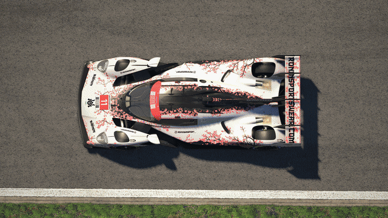

# iRacing Screenshot Tool v3.6.0

A Capture Grid release. One click now takes a picture of every car in the
field at exactly the same spot on track. Use it for grid line-ups, team and
league galleries, or a season "top shot" of the whole field.

_A 60-car field, every car shot at the same spot with Capture Grid._

## New

### Capture Grid

Capture Grid goes through the replay for you. For each car you pick, it
switches the camera to that car, finds the moment that car passed the same
spot, and takes the shot. You don't have to scrub or line anything up
yourself.

**How to use it**

1. Open a replay in iRacing. Put the camera on a car, at the spot where you
   want every car to be pictured. That car's position on track is the spot
   for the whole grid.
2. In the tool's sidebar, open **Capture grid** and choose the cars. Tick a
   class to take all of its cars, open it to pick cars one by one, or use
   **All** and **None**.
3. Click **Capture grid**. The button shows how many cars are selected.
4. Leave it running. A banner at the top of the screen shows which car it
   is on. Cars are shot in race order at the moment you chose.
5. When it finishes, the replay and the camera go back to where you left
   them. Click **Open folder** to see the shots. Each grid gets its own
   folder, named after the track and the time, inside your screenshot
   folder.

Each car takes a few seconds, so a full 60-car field takes a few minutes.

**Tips**

- **Use a chase or cockpit camera.** They frame every car the same way.
  TV and scenic cameras pick their own angle for each car, so the framing
  will vary. The panel warns you when one is selected.
- **Room around each car.** "Minimum gap to other cars" is set to 20 m. If
  another car is closer than that, the tool shoots the same spot one or two
  laps earlier or later instead. Set it to 0 to turn this off.
- **The camera stays put.** If the camera is moved while a car is being
  shot, for example by a stray key press in iRacing, the tool puts it back
  and takes that shot again.
- **ReShade works too.** In ReShade mode the tool lines up each car, then
  waits for you to press your ReShade screenshot key. **Skip car** moves on
  without a shot.
- **Cars that couldn't be shot are listed** with the reason, for example
  when that spot happened before the start of the recorded replay. Cars in
  the pit lane are included. The pace car never is.
- Outside ReShade mode, Capture Grid needs **High-Fidelity Capture (WGC)**,
  which is on unless you turned it off in Settings.

### A progress banner over iRacing

While a grid or a long exposure runs, iRacing covers the tool's window, so
you couldn't see what was happening. A small banner at the top of the
screen now tells you. During a long exposure it shows a progress bar that
fills smoothly. In ReShade mode it reminds you when to press your ReShade
key, for normal screenshots too. The banner never shows up in your shots.

### Stop with one key

Press **Esc** to stop a running grid or long exposure. The banner reminds
you of the key. To use a different one, go to **Settings**, then
**Abort Keybind**. The key only does this while a grid or long exposure is
running, so Esc works as usual the rest of the time.

## Changes

- **Long Exposure is translated.** The Effects warm-up and Passes settings
  and their help text, added in v3.5.0, now appear in all 19 other
  languages.
- **Capture Grid is in English for now** in every language. Translations
  will follow in a later release.

## Fixes

- **A clear message when Windows blocks the tool from controlling
  iRacing.** This usually happens when iRacing, or the program that starts
  it, runs as administrator. Before, screenshots came out at your screen
  size whatever resolution you picked, and long exposures failed with "The
  replay did not reach frame…". Now the tool tells you up front, names the
  program that started iRacing when that is the cause, and explains what to
  untick. If the tool and iRacing both run as administrator, the message
  says to change both.

## Notes

- If you are on v3.4.0 or later, the tool offers this update itself. Click
  the update icon at the top of the window.
- Windows may say it "protected your PC" the first time you run the
  installer. Click More info, then Run anyway. The release isn't digitally
  signed yet. Signing is in progress.
- iRacing still needs to run in Windowed Borderless. In iRacing's Full
  Screen mode, captures still come out black.
- Neither iRacing nor this tool should run as administrator. Windows stops
  the two from working together when either one does.

## Get it

- Installer, which most people want: `iRacing-Screenshot-Tool-Setup-3.6.0.exe`
- Portable, runs without installing: `iRacing-Screenshot-Tool-3.6.0.exe`
